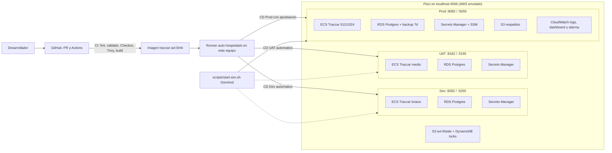

# Diagrama de ambientes Dev, UAT y Prod

Fuente Mermaid del diagrama propio. La version vectorial esta en [diagrama.svg](diagrama.svg).

Notas:

- El estado de Terraform vive en Floci, con un key por ambiente (`dev/`, `uat/`, `prod/`).
- La misma imagen (SHA) se promueve; no se recompila en Prod.
- El simulador GPS apunta por defecto a Prod (puerto 5055) y acepta otra URL por variable.
